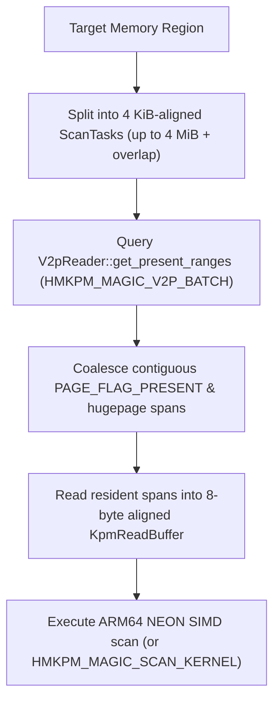

# Memory Scanning & Search Engine

HuntMemory's core memory scanning engine is written in **Rust Edition 2024** and optimized with **ARM64 NEON SIMD intrinsics**, providing maximum throughput when filtering gigabytes of process memory.

---

## ⚡ 1. ARM64 NEON SIMD Vectorization

During memory scanning, HuntMemory compares blocks of memory using 128-bit vector registers (`v0`-`v31`) via `std::arch::aarch64`.

### Vectorized Scan Operations

- **8-bit Integers (`i8` / `u8`)**: Processes **16 elements per cycle** using `vld1q_s8` and `vceqq_s8` / `vcgtq_s8` / `vcltq_s8`.
- **16-bit Integers (`i16` / `u16`)**: Processes **8 elements per cycle** using `vld1q_s16`.
- **32-bit Integers (`i32` / `u32`)**: Processes **4 elements per cycle** using `vld1q_s32`.
- **64-bit Integers (`i64` / `u64`)**: Processes **2 elements per cycle** using `vld1q_s64`.
- **32-bit Floats (`f32`)**: Vectorized comparison using `vld1q_f32` and `vceqq_f32` with IEEE 754 epsilon handling.
- **64-bit Doubles (`f64`)**: Vectorized equality checks with `vld1q_f64` and `vceqq_f64`.

Mask extraction is performed efficiently using bitwise reduction (`vmaxvq_u8` / `vaddv_u8`) to quickly skip unmatching SIMD lanes without scalar branch penalties.

---

## 🧩 2. V2P-Guided Chunked Memory Reader

Process memory on Android often contains sparse, uncommitted, or guard pages within mapped virtual ranges.

### The V2P Resident-Range & 4 MiB Chunk Pipeline

1. `build_scan_tasks` partitions target regions into 4 KiB-aligned `ScanTask` slices of up to **`CHUNK_SIZE` (4 MiB)** with a boundary overlap window (`max_step - 1`) to preserve matches spanning slice boundaries.
2. Worker threads (up to 8 via `std::thread::scope`) query `V2pReader::get_present_ranges` (`HMKPM_MAGIC_V2P_BATCH`, 4096 pages per batch) to coalesce contiguous `PAGE_FLAG_PRESENT` pages and hugepage blocks into resident `(start_addr, end_addr)` intervals.
3. Only resident intervals are read into reusable 8-byte aligned `KpmReadBuffer` buffers and scanned via ARM64 NEON SIMD intrinsics, or dispatched directly to kernel space via `HMKPM_MAGIC_SCAN_KERNEL` when `ScanEngineMode` selects in-kernel scanning.

---

## 🗺️ 3. Memory Region Classification & Filtering

Memory regions are streamed from `/proc/<pid>/maps` (with `HMKPM_MAGIC_ENUM_REGIONS` fallback when `/proc/<pid>/maps` is inaccessible) and filtered for physical residency via `V2pReader` (`HMKPM_MAGIC_V2P_BATCH`).

### Memory Region Types

| Code | Region Type | Path / Allocation Pattern |
| :--- | :--- | :--- |
| **`[A]`** | Anonymous | `[anon:*]`, unlabelled private mappings |
| **`[CA]`** | C++ Alloc | `[anon:libc_malloc]`, `[anon:scudo:*]`, `[anon:jemalloc]`, `[anon:GWP-ASan]` |
| **`[CB]`** | C++ BSS | `[anon:.bss]`, `[anon:bss]` |
| **`[CD]`** | C++ Data | `/data/app/*`, `/data/data/*`, `/data/user/*` |
| **`[CH]`** | C++ Heap | `[heap]` |
| **`[JH]`** | Java Heap | `/dev/ashmem/dalvik*`, `[anon:dalvik-*]`, `[anon:art_*]`, `[anon:main space]`, `[anon:region space]` |
| **`[S]`** | Stack | `[stack]`, `[stack:*]` |
| **`[AS]`** | Ashmem | `/dev/ashmem*`, `[anon:ashmem]` |
| **`[NL]`** | Native Libs | `*.so` native shared libraries |
| **`[F]`** | Files | Mapped filesystem files (`/data/*`, `/system/*`, etc.) |
| **`[CUSTOM]`** | Custom Filter | Regex or substring match against path names |

### Contiguous Region Consolidation (`merged_count`)
Contiguous adjacent memory mappings sharing identical permissions, paths, and continuous file offsets are automatically consolidated into single unified entries with a `merged_count` indicator, significantly reducing memory table clutter and kernel scan dispatch overhead.

### V2P Residency & Memory Safety Rules
- **Non-File Anonymous Regions**: Checked through `V2pReader` (`HMKPM_MAGIC_V2P_BATCH`) using `PAGE_FLAG_PRESENT` before reading, skipping uncommitted virtual allocations without opening procfs page-map file descriptors.
- **Swappable Regions (`include_swapped`)**: Regions matching `region_supports_swap` (such as `[heap]`, `[stack]`, allocators, `.bss`, Dalvik/ART spaces, and `ashmem`) are preserved during map enumeration when `MapsOptions::include_swapped` is enabled.
- **Memory Write Verification**: Write paths (`write_raw_bytes`, `write_value`, `write_obscured`, `write_big_double`, `batch_write_binary`, Lua writes, and `FreezeEngine`) validate `PAGE_FLAG_PRESENT` via `v2p::is_page_present` on boundary pages before dispatching kernel writes.
- **Chunk Boundary Overlap**: `ScanTask` slices across 4 MiB chunks use an overlap window (`max_step - 1`) gated by `[emit_start, emit_end)` so multi-byte values crossing chunk boundaries are never split or duplicated.

---

## 🎯 4. Scanning Modes & Capabilities

### 1. Exact Value Scan
Finds variables matching a specific value with exact type representation:
- Supported types: `Byte`, `Short`, `Int`, `Long`, `Float`, `Double`, `Float16`.
- Supports hexadecimal input formats (`0x100`, `-0x20`).

### 2. Multi-Type / Auto Scan
Specifying `Auto` or combining types (e.g. `int, float, double`) searches all selected types simultaneously across memory in a single pass.

### 3. Range Scan
Finds values within a specified minimum and maximum boundary:
`minValue <= X <= maxValue`

### 4. Group Scan (Heterogeneous & Homogeneous Structs)
Locates grouped variables and struct fields situated close to each other in memory within a specified byte distance.
- **Homogeneous format**: `100;200;300:16` (finds 100, 200, and 300 within 16 bytes distance).
- **Heterogeneous format**: `f64:100.5; i64:5000 : 32` (finds typed variables with distinct sizes).

### 5. Array of Bytes (AoB) & Signature Scanning
Searches for byte sequences with wildcard mask support:
- **Pattern Format**: Space-separated hex bytes with `?`, `??`, or `*` wildcards (e.g. `00 20 40 ? ? 90 00`).
- **Bitwise Evaluation**: Matches exact bytes through `(byte & mask) == target`, ensuring wildcard bytes (`mask = 0x00`) match any byte in RAM.
- **Chunk Window Overlap**: When scanning across multi-megabyte memory chunks, an overlap rewind window of `pattern_length - 1` prevents signatures spanning block boundaries from being split or omitted.

### 6. Unknown & Relative Scans
Supports initial scans without known values, followed by differential refinement passes:
- **`▲ Increased`**: Value has increased compared to the previous pass.
- **`▼ Decreased`**: Value has decreased compared to the previous pass.
- **`~ Changed`**: Value has changed from the previous scan.
- **`= Unchanged`**: Value remains identical.
- **`+ Increased By (X)`**: Value has increased by exactly `X`.
- **`- Decreased By (X)`**: Value has decreased by exactly `X`.

---

## 🔬 5. Half-Precision Float (`Float16`) Processing

HuntMemory provides full native support for **IEEE 754 16-bit half-precision floating-point numbers (`Float16` / `f16`)**:
- **Layout**: 1 sign bit, 5 exponent bits, and 10 fraction bits.
- **Subnormal & Denormal Handling**: Normalized using branchless leading-zero computation (`CLZ` on ARM64) to maintain precision without scalar exceptions.
- **Conversion Pipelines**: Direct bitwise conversion functions (`f16_to_f32` and `f32_to_f16`) allow seamless filtering, range evaluation, and memory editing of mobile shaders and compact float arrays.

---

## ⚡ 6. High-Throughput Binary Serialization

To eliminate JSON serialization and garbage collection pauses across the JNI bridge when dealing with millions of scan matches:
- **`encode_regions_binary`**: Serializes `/proc/[pid]/maps` region structures into a dense binary byte array with 8-byte aligned addresses and 4-byte ASCII permissions.
- **`encode_matches_page_binary`**: Streams paginated scan results to the Android UI using compact fixed-width structures (8 bytes address, 8 bytes start/end, 1 byte type code, 4 bytes permissions, length-prefixed value strings).

---

## 🔐 7. Obscured Types & Scientific Notations

### Obscured XOR Keypairs
Some runtimes store numeric variables (e.g., counters, telemetry metrics) as XOR-encoded key-value pairs:
$$\text{hiddenValue} = \text{targetValue} \oplus \text{xorKey}$$
- **`ObscuredInt` / `ObscuredFloat`** (8 bytes: 4-byte key + 4-byte XOR-encoded value).
- **`ObscuredDouble` / `ObscuredLong`** (16 bytes: 8-byte key + 8-byte XOR-encoded value).

HuntMemory scans, decodes, and writes obscured types directly, automatically handling random key rotation or key preservation.

### BigDouble Scientific Structs (BreakInfinity / Decimal)
Simulation and scientific runtimes frequently utilize extended-range numeric libraries represented as mantissa and exponent structs:
$$\text{Value} = \text{mantissa} \times 10^{\text{exponent}}$$
- **16-byte format**: `{ mantissa: f64, exponent: i64 }`
- **12-byte format**: `{ mantissa: f64, exponent: i32 }`

Format parsing supports scientific notation directly (e.g., `1.5e12` or `1.5,12`).

---

## ❄️ 8. Memory Freeze Engine

- **Native Background Worker**: Managed via a dedicated thread in `editor.rs` synchronized with `Arc<(Mutex<FreezeState>, Condvar)>`.
- **Atomic Registration**: Addresses are registered with their target value and partitioned by `(pid, address)`.
- **Physical Page Validation**: Verifies `PAGE_FLAG_PRESENT` via `v2p::is_page_present` prior to dispatching writes.
- **Configurable Tick Rate**: Operates at configurable tick intervals (default: **100ms**) using batched kernel writes to minimize CPU wakeups.
